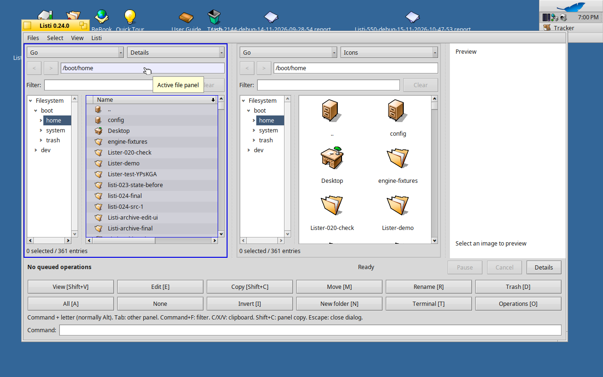
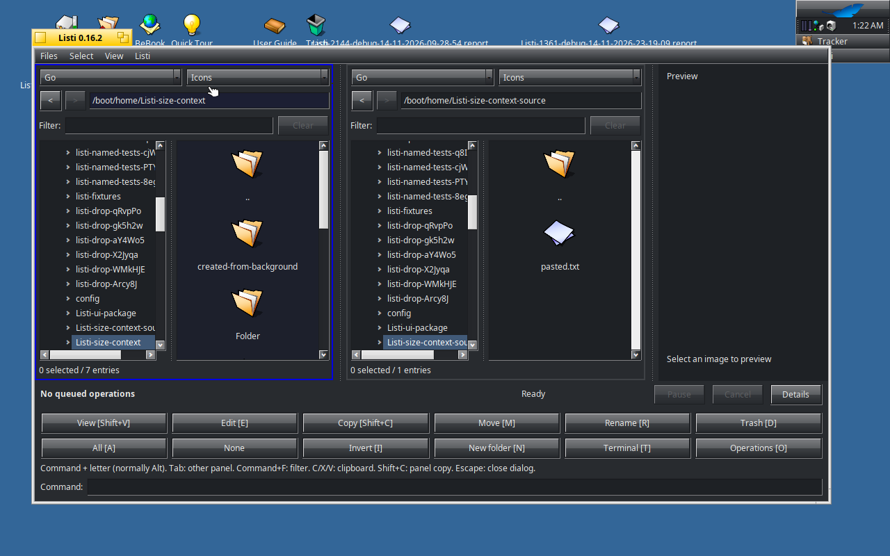

# Listi

## Alpha / WIP: risk of data loss

**Listi is under active development and testing. It is not a stable release.**
It operates on files on your computer, and bugs can cause data loss or corruption,
including during copying, moving, editing or deleting files. **All use is at your
own risk. We do not recommend using it unless you understand and accept these
risks.** Test only on disposable copies of data and keep independent backups.

Binaries are primarily intended for bug testing, not dependable everyday use.
You are welcome to test, but please [contact us by reporting serious bugs on
GitHub](https://github.com/kambuziarendal/listi/issues). Include the version,
Haiku version, what happened and reproduction steps where possible. Do not
include passwords or private files in a public report.

## Screenshots: DOpus view

**DOpus** is our chosen name for Listi's dual-panel workspace, previously called
**Commander**. Existing builds still use the Commander menu label; the in-app
rename is planned, not implemented. Listi is an independent implementation,
not Directory Opus or an affiliated product.

These are actual Commander-view captures from earlier native Haiku tests,
labelled with their original versions. They are not screenshots of 0.31.0.
Folder trees and preview are optional in this workspace and are enabled here.

### DOpus view: light appearance, Listi 0.24.0

### DOpus view: dark appearance, Listi 0.16.2

A native Haiku file commander by Kambuzi EDB, inspired by the source/destination
workflow of Directory Opus 5. New MIT implementation, not a port or a compatible
replacement. Development alpha: **0.31.0**. Historical published alpha: **0.2.0**.

We are building Listi primarily because we miss DOpus on Haiku. Useful ideas from
other file managers support that identity, not replace it.

0.31.0 focuses on stability: recoverable directory delivery, retained queue
results, bounded archive-read reuse and network recovery after lost replies.
No new user-facing features are introduced. See [verification and measured limits](docs/STABILITY-0.31.0.md).

0.30.0 adds combinable date, byte-size and extension filters to Find files,
including saved criteria and advanced/live BFS searches. See
[search filters and limits](docs/SEARCH-FILTERS-0.30.0.md).

0.29.0 adds verified Cut/Paste and panel Move between local folders and writable
archives, in both directions. Full destination read-back precedes source removal;
unsupported local metadata retains the source. See [archive/local moves](docs/ARCHIVE-LOCAL-MOVE-0.29.0.md).

0.28.0 adds read-only recursive folder comparison with quick byte-size checks or
SHA-256 content verification. **Listi > Compare folders** starts from the two
panels. Right-click a file and choose **Select same file type** to select visible
files with the same extension. See [comparison and selection](docs/COMPARE-0.28.0.md).

0.27.0 adds external editing of writable archive files with verified automatic
save-back, conflict detection and retained private working copies. See
[archive editor behavior and recovery](docs/ARCHIVE-EDITOR-0.27.0.md).

0.26.0 adds clipboard Cut/Paste and panel Move between writable local archives.
The destination is saved and verified byte-for-byte before source removal.
Interrupted cleanup can leave both copies. See [archive move behavior](docs/ARCHIVE-MOVE-0.26.0.md).

0.25.0 connects ordinary Copy/Paste and drag-and-drop to transactional archive
editing. Writable archives also support new folders, rename, delete and moves
within the same archive. See [archive folder behavior and remaining limits](docs/ARCHIVE-FOLDERS-0.25.0.md).
This is not universal archive filesystem parity; format and engine capabilities
still matter. The [bughunt notes](docs/BUGHUNT-0.25.0.md) describe safety fixes.

Find files: **Command+Shift+F** opens cancellable recursive local name search
and native BFS formulas, with optional live updates. Save named criteria and
reopen them for fresh results. Results show original folders; reveal an original
in its owning panel before using file actions. See [live and saved search behavior
and limits](docs/SEARCH-0.8.0.md). General attribute builders, multiple volumes,
content search and Tracker query-file interoperability remain open requirements.

Saved work locations: each panel's Go > Places menu can save the current
location, rename it or forget it. Names are shared across the two panels and
persist across restarts. Local folders, archive folders, server addresses and
the disks overview are supported. Credentials remain session-only; reconnect
to an authenticated server before reopening its saved location after restart.
See [saved places and bughunt](docs/PLACES-0.6.0.md) and the additional
[Tracker capability requirements](docs/TRACKER-COVERAGE.md).

Two independent resizable panels, editable paths and location menus, sortable
name/size/date columns, multiselection, drag-copy, node monitoring, a command
button bank, viewer, editor and terminal launch, and saved display preferences.
Native Haiku controls and system colours, including dark themes.

Properties: **Files > Properties** or **Command+Shift+I** opens one local entry.
Inspect file information and edit supported typed BFS attributes and ordinary
permissions explicitly. See [behavior and limits](docs/PROPERTIES-0.10.0.md).

Duplicate one local entry beside its original with **Command+Shift+D**.
Create a relative or absolute symbolic link in the other panel with
**Command+Shift+L**. Both require an unused name and preserve existing entries.
See [behavior and limits](docs/NAMED-ENTRIES-0.13.0.md).

Right-click a file or folder for context actions in either panel view.
Existing multi-selection is preserved when clicking an already selected entry.
Right-click empty space, or use **This folder** at the top of any file menu,
for actions on the current folder. Selection status includes total file size;
folders and links are counted separately without scanning their contents.
See [selection and folder actions](docs/SELECTION-CONTEXT-0.16.2.md).
See [context menu behavior](docs/CONTEXT-MENU-0.14.0.md).

## Archive jobs

**Files > Archives** or the right-click **Archives** submenu creates archives
(**Command+Shift+P**) or extracts to a new folder (**Command+Shift+E**) in all
workspaces. ZIP, 7z, tar.gz, tar.xz and tar writers are probed from the optional
system libarchive. Choose favorites, a default format and compression level.
Existing targets are never replaced. See [archive workflows and limits](docs/ARCHIVES-0.18.0.md).

## Workspaces

**View > Workspace** selects Simple, Explorer, Commander or Workbench. Workbench
starts with both folder trees and the image preview visible, while retaining the
two-panel command tools. Its tree and preview choices are stored separately from
Commander. Switching reuses the same panels and preserves paths, selection,
splitters and running jobs. See [Workbench behavior](docs/WORKSPACES-0.25.0.md),
[Explorer behavior](docs/WORKSPACES-0.17.0.md) and
[code audit findings and limits](docs/AUDIT-0.17.0.md).

## Workflow

The bold active panel supplies selected files. Direct panel Copy/Move uses
the other panel as destination; clipboard Paste uses the active panel. Click a panel or press Tab in a list to switch roles. Double-click
a directory to enter it; Backspace goes up. Use Haiku's **Command modifier**
(normally **Alt**, following your system keymap) plus **C/X/V** to copy/cut/paste
local files using the system clipboard, including Tracker. The mouse route is
**Files > Clipboard**. **Shift+C** copies directly to the other panel;
**Shift+V** opens the viewer. **E** edits, **M** moves to the other panel,
**R** renames, **N** creates a folder, **D** trashes and **F** filters.
Buttons and menus show their shortcuts. See [clipboard behavior and limits](docs/CLIPBOARD-0.9.0.md). Bare letters remain
available for list type-ahead. In path, filter, command and name fields,
Command+A/C/X/V selects/copies/cuts/pastes text, never files. Press Enter after
editing a path or filter to return to the list. Escape cancels a name dialog.
Function keys are unassigned. Alt+W follows Haiku’s window-close behavior;
Alt+Q quits Listi. Escape cancels an inline question.

Each panel has its own **< Back / > Forward** path buttons. **Command+[ / ]**
work while browsing that panel, not while editing text or answering a question.
Up to 64 successful locations are kept for this session only, including local,
archive, server, volume and Trash locations. Failed or cancelled scans do not
become visits. Back from a failed open first retries the last successful place.
Refresh preserves the forward branch; visiting a new place discards it. Returning
reloads contents without restoring an old selection. History is not file undo.

Operations run on a worker queue. The inline Operations area shows progress,
Pause/Resume, Cancel and Replace/Replace all/Skip/Skip all/Abort conflicts.
Escape closes the active question first; otherwise it cancels a pending conflict
and collapses Operations. The action-button bank gives way to an open question
and returns when it closes; menu actions and shortcuts remain available. The main window will not quit
while an operation is active. Command+D / Trash moves entries to Haiku's per-volume Trash, with Tracker-compatible
restore metadata. Open it using a panel's Go menu, then select **Files > Restore
from Trash**. Restore never overwrites an existing file; the original parent
folder must still exist. Unsupported/read-only volumes return an error without
silently deleting anything. **Files > Delete permanently...** is a separate,
confirmed action and cannot be undone. Cancellation keeps completed entries and removes the current partial
regular file. A partially copied directory can remain.

## Narrow, select, act

Each panel has a literal name filter. Use **Listi > Filter names** (Alt+F on
default Haiku), type part of a name, then Enter to return to the list. Escape in
the field or Clear removes the filter. The status shows the visible/total count.
Hidden entries are deselected and stay deselected when revealed again. Select All
and file operations affect only visible selections; `..` remains navigable.
Changing folder clears the filter; refreshing the same folder preserves it. This
is a local view filter, not recursive search or wildcard expansion.

## Install and build

Install the privately supplied candidate in Haiku:

    pkgman install ./Listi-0.6.0-1-x86_64.hpkg

Listi replaces Lister in Apps and Deskbar. The package identity (`lister`),
application signature (`application/x-vnd.Kambuzi-Lister`), scripting suite and
preferences (`~/config/settings/Lister_settings`) intentionally remain compatible.
There is no settings migration or duplicate Lister launcher. Keep the old HPKG
for application rollback; the GitHub repository name has not changed.

Build the current native application **inside Haiku x86_64**. A future portable
C core will have separate POSIX tests; it does not exist in this release.

    gcc --version
    pkgman install haiku_devel python3 libarchive_devel curl_devel samba4_devel
    make
    make test
    make package

`make` uses Haiku makefile-engine. The executable is in
`src/objects.*-release/Listi`, not the project root. `make package` uses
PackageInfo and produces `dist/Listi-0.16.3-1-x86_64.hpkg`. Retain previous
packages for rollback; reinstalling one does not restore or roll back files you
have copied, moved or deleted.

See [design](docs/DESIGN.md), [roadmap](docs/ROADMAP.md) and
[verification](docs/VERIFICATION.md). No accounts, telemetry or paid services.

## Internal 0.4.0 features and limits

Use **Command+K** to connect to SMB, SFTP, FTP or FTPS. Credentials stay in memory. Tab between fields without connecting; use Connect or Enter to submit.
SFTP needs an existing trusted known_hosts file. FTP is unencrypted. Package
requirements install libcurl and libsmbclient. Archive support uses the optional
`libarchive` system package; install it from HaikuDepot when needed. Backend errors are
reported without pretending an unsupported operation succeeded. SMB, SFTP and
FTP are tested with synthetic servers; FTPS and external NAS models are not yet
qualified.

Archive browsing and extraction stay inside Listi. The adapter loads the system's
optional libarchive, not an archive GUI or a bundled private engine. ZIP, 7z,
RAR/RAR5, tar, CPIO, ar, ISO, XAR, CAB and LHA are covered by native fixture tests.
Single-file gzip/bzip2/xz/lzma and compressed tar are supported. LZ4 needs the
optional `lz4` package; Zstandard needs `zstd_bin`. Install system packages through
HaikuDepot and retry without restarting Listi. See [archive support](docs/ARCHIVES-0.16.0.md)
for tested variants and current limits. Archives remain read-only and local.
Cross-location moves are refused with Copy guidance; remote Trash is not emulated.

Each panel's View menu selects details, icons, large icons or thumbnails, remembers
a folder-specific view, restores its default, and toggles an independent folder
tree. **Command+P** toggles image preview. The expanded 1024x650 laptop layout is
qualified at the default font size; larger accessibility fonts may need more room.
Tree branches are refreshed by closing/reopening their tree. New uncached paths
rebuild the route automatically. Thumbnail replies/caches, preview decoding,
folder preferences, tree nodes and operation history have explicit bounds.

This is a private candidate, not a Dolphin-parity or performance claim. See
[the current qualification](docs/INTERNAL-CANDIDATE.md) for exact tested scope,
recovery and limitations. Dependency licenses remain their own; MIT covers Listi's
source, not every library provided by Haiku packages.

Private 0.11.0 adds MIME inspection and one-time native application choice via
Files > Open with (Command+Shift+O). Associations remain unchanged.
See docs/OPEN-WITH-0.11.0.md for scope and recovery.

Private 0.12.0 adds explicit Copy here / Move here / Cancel for local drops.
The destination is always the receiving panel's current folder, shown before
transfer. Network/archive drops retain explicit copy only. See docs/DROP-0.12.0.md.

Workspace candidate: View > Workspace > Simple or Commander. Simple keeps one
file panel without the action bank; clipboard and right-click actions remain
available. See [workspace behavior](docs/WORKSPACES-0.15.0.md).

## Minimal workspace and mouse selection (0.16.0)

Simple shows the address, file list and compact status only. Go, the pane view
selector, filter and navigation buttons are hidden. Use View > File view for
Details/Icons/Large icons/Thumbnails. Hidden Commander filters are suspended in
Simple and restored when returning to Commander. No function keys are assigned.

Drag from empty list space to select a rectangle in either renderer. Ctrl or
Shift adds to the original selection. Escape restores that original selection.
Dragging an item still starts file drag-and-drop. Selection scrolls at the edges.

Commander identifies the active panel with a thin themed outline and subtle
address/file-area tint, without left/right labels. Only the outline briefly
animates on panel switches; Simple stays neutral.

### Password-protected archives

Encrypted ZIP is read by optional libarchive. Install optional **p7zip** for
7z and RAR/RAR5, including encrypted filenames. Browsing, previews and extraction
stay inside Listi. Passwords are requested in a masked field and cached only in
memory; **Files > Archives > Forget archive passwords** clears the cache.
See [password handling](docs/ARCHIVES-0.19.0.md) and
[7z/RAR support and limits](docs/ARCHIVES-0.20.0.md).
[Multipart archives](docs/ARCHIVES-0.21.0.md) support `.7z.001`, `.part1.rar`
and `.rar/.r00` sets. Keep the parts together and open any part. Encrypted archive
creation for ZIP and 7z is described in [the 0.22.0 archive notes](docs/ARCHIVES-0.22.0.md).
[Safe editing](docs/ARCHIVES-0.23.0.md) can add, replace and remove entries in
local, single-volume ZIP and 7z archives while retaining supported encryption.
