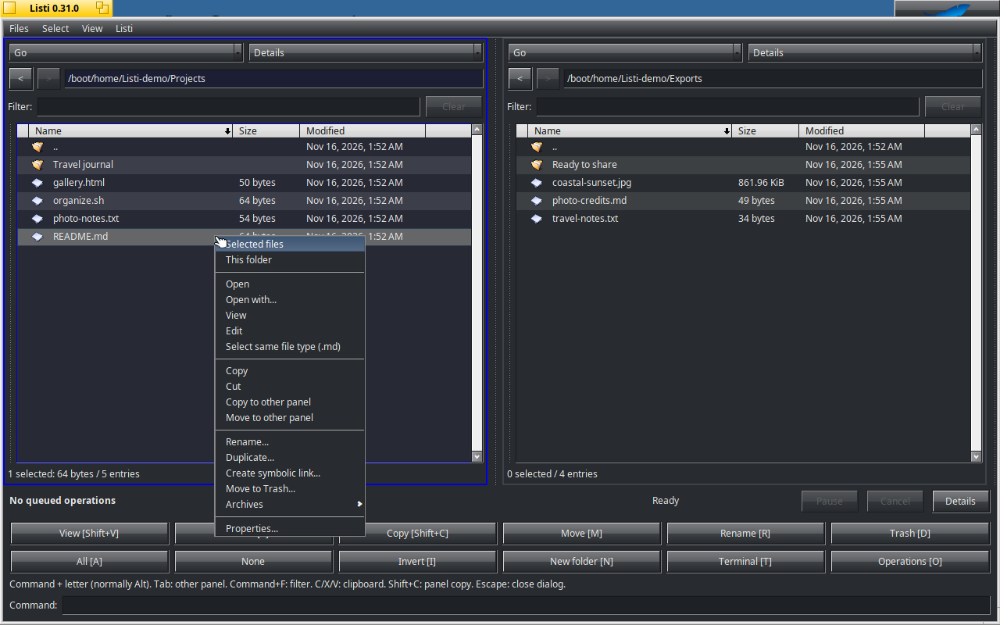
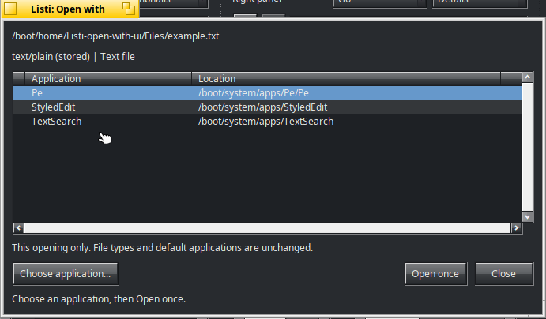

# Listi

**A native Haiku file manager, from quick browsing to focused two-panel work.**

Listi brings source/destination file work together with Haiku's native controls,
BFS attributes, queries, MIME applications and Tracker interoperability. Start
with one file list, add a folder tree, work across two panels, or bring more tools
together in the Smiðja workspace.

[Download 0.32.0 alpha](https://github.com/kambuziarendal/listi/releases/tag/v0.32.0)
· [Workflow guide](docs/GUIDE.md)
· [Roadmap](docs/ROADMAP.md)
· [Report a bug](https://github.com/kambuziarendal/listi/issues)

## What changed in 0.32.0

- **Customise the workspace:** choose and order command buttons, position modules in fixed zones, and save named layouts. Compact buttons for narrow windows are opt-in.
- **Work across folders:** browse in Miller columns, collect local files on the session Shelf, preview bulk renames and swaps with guarded undo, convert a dropped image, or save clipboard text and PNG images as files.
- **Review file operations:** inspect or cancel a specific queued job. Partial local moves report which entries were moved and which sources were retained. If a destination copy changes before cleanup, Listi stops rather than deleting the source.
- **Keep actions on the intended file:** a replacement at the same local path no longer inherits selection on refresh. Paste and drop reject colliding output names. Restore refuses an original folder redirected into Trash. Unreadable settings are preserved.
- **Work with more archives:** supported single-volume RAR5 archives can be rebuilt in Store mode. CAB, ARJ and LHA/LZH have format-specific writing limits and optional dependencies. See the [archive guide](docs/GUIDE.md#archives) before editing an existing archive.

The [roadmap](docs/ROADMAP.md#feature-directions-and-current-foundations) distinguishes shipped features from plans. Folder comparison is read-only; duplicate finding, directory synchronisation and persistent job history are not in this release.

| Smiðja: a file workbench | Tvískipt: source and destination |
|---|---|
|  |  |
| Panels, folder trees, image preview, filters and actions in one layout. | Direct file work with the destination alongside the source. |

Real Haiku captures from 0.31.0, before the workspace rename. That build uses
**Workbench** and **Commander** for Smiðja and Tvískipt. The current release uses
the names below. [Screenshot versions and credits](docs/screenshots/CREDITS.md).

> **Development alpha — test with disposable copies and independent backups.**
> Listi can change or delete files, and bugs can cause loss or corruption. The
> binaries are primarily for bug testing, not dependable everyday use. Installing
> an older package does not undo file operations.

## Four workspaces, the same file actions

| Workspace | Layout | Useful for |
|---|---|---|
| **Einn** (`einn`) | One file panel in Details by default | Simple, Tracker-like browsing |
| **Askr** (`askr`) | Folder tree on the left, file list on the right | Navigating a folder hierarchy |
| **Tvískipt** (`tviskipt`) | Two file panels side by side | Copying, moving and comparing locations |
| **Smiðja** (`smidja`) | Panels, configurable sidebars, file preview and action controls | Keeping several tools close at hand |

Switching workspace retains panel locations, selections and running jobs. Einn
and Askr show the active panel; the other panel is hidden, not discarded.

### About the names

A little Norse character, with meanings that fit the job. The names mix Old
Norse words and modern Icelandic forms; they are not all medieval vocabulary.

- **Listi** is Icelandic for a *list* or *catalogue*: a straightforward name for
  an application built around lists of files. The word is a later borrowing,
  not an Old Norse term.
- **Einn** means *one* in Old Norse and Icelandic. One panel, one place to focus.
- **Askr** is Old Norse for an *ash tree*. Here, the connection is the folder
  tree beside the file list—not a claim that it literally means “file tree.”
- **Tvískipt** means *divided in two* in Icelandic, built from **tví-** (*two*,
  *double*) and **skipta** (*divide*). Two panels, side by side.
- **Smiðja** means a *smithy* in Old Norse and Icelandic: a place for tools and
  making things. That is the idea behind the workbench layout.

*If the names seem a little odd—fair enough. Whatever. I like them.*

Word references: [listi](https://en.wiktionary.org/wiki/listi#Icelandic),
[einn](https://en.wiktionary.org/wiki/einn#Old_Norse),
[askr](https://en.wiktionary.org/wiki/askr#Old_Norse),
[tví-](https://en.wiktionary.org/wiki/tv%C3%AD-),
[skipta](https://en.wiktionary.org/wiki/skipta#Icelandic) and
[smiðja](https://en.wiktionary.org/wiki/smi%C3%B0ja#Old_Norse).

## Available in the alpha

### Browse, select and organise

- Independent, resizable panels with editable paths, sortable columns, details,
  icon and thumbnail views, and optional folder trees.
- Per-panel Back/Forward history, saved places and display preferences.
- Literal name filters, multiple selection, invert selection and **Select same
  file type** by extension, including compound suffixes such as `.tar.gz`.
- Copy, move, rename, new folders, duplicate and relative or absolute symbolic
  links for supported local entries.
- Local drag-and-drop with an explicit Copy/Move/Cancel choice. Archive and
  network drops use copy semantics rather than silently inferring a move.

### Keep file work visible

- A worker queue with progress, pause/resume, cancellation and a details log.
- Explicit Replace, Replace all, Skip, Skip all and Abort conflict choices.
- Accepted jobs retain their original selection and target while you navigate.
- Temporary-file copies, source identity checks and visible partial outcomes.
  These safeguards are not filesystem transactions or a universal undo system.
- Native Trash with Tracker-compatible restore metadata, and a separate,
  confirmed permanent-delete action.

### Use Haiku's native tools

- Native controls, system colours and Tracker/MIME icons, including dark themes.
- Clipboard interoperability with Tracker and local file-change monitoring.
- Properties for local entries: timestamps, permissions and supported typed BFS
  attributes. System namespaces and unsupported data remain read-only.
- **Open with** chooses a native application for one local file without changing
  file associations. Viewer, external editor and terminal launch are also present.

### Find and compare

- Cancellable recursive name search, date/size/extension filters, saved search
  criteria and advanced BFS queries with optional live updates.
- Read-only recursive folder comparison by names and sizes or SHA-256 content.
  Results distinguish missing entries, type/size/content differences and errors.
- Search results refer to original files; comparison does not synchronise them.

| Search with several criteria | Inspect content differences |
|---|---|
|  |  |
| Saved criteria, extension, byte size and inclusive calendar dates. | Size checks or SHA-256, with paths and per-entry results. |

Feature captures from 0.30.0 and 0.28.0. These workflows remain available in the
current alpha; the images are not captures of 0.32.0.

### Browse and work inside archives

- Browse many formats including ZIP, 7z, RAR, tar, ISO, CAB and LHA through
  optional system libraries and engines.
- Create and extract supported formats, with favourite/default format choices
  and compression options. Writable local archive folders support Copy/Paste,
  new folders, rename and entry removal.
- Read selected encrypted ZIP/7z/RAR variants and local multipart 7z/RAR sets;
  supported ZIP/7z creation can use encryption.
- Rebuild supported local archives to add, replace or remove entries. Edit a
  member through an external editor with verified save-back and retained working
  copies for recovery.
- Supported archive-to-archive and archive/local moves verify destination content
  before source cleanup. These are not atomic two-location transactions.

Listi can rebuild supported single-volume RAR5 archives in their original
format using Store (no compression). RAR4 writing, remote/split/nested archive
mutation and full metadata preservation are not supported. Decrypted editing copies may remain on disk: see the
[archive limits and recovery guidance](docs/GUIDE.md#archives).

### Connect to network locations

SMB, SFTP, FTP and FTPS connections use the panel and queue workflow. Browse and
transfer against a local panel without switching to a separate file-transfer
application. Credentials stay in memory rather than saved ordinary settings.
Capabilities, identity checks and recovery vary by protocol and server; not every
NAS or WAN condition is qualified.

### Inspect metadata and choose applications

| Native properties | Open once with an application |
|---|---|
|  |  |
| Inspect and explicitly edit supported local attributes and permissions. | Choose a registered native application without rewriting associations. |

Cropped feature captures from 0.10.0 and 0.11.0. Only the application windows are
shown; no UI content has been retouched. See the [workflow guide](docs/GUIDE.md)
for scope and limitations across all these features.

## Little things that make file work easier

- **Choose what a right-click acts on:** switch between **Selected files** and
  **This folder**. The latter means the panel's current folder, not the clicked
  subfolder.
- **Select matching types:** right-click a file to select visible files with the
  same extension, including recognised compound suffixes such as `.tar.gz`.
- **Sort without changing the task:** Name, Size or Modified, ascending or
  descending. This is separate from same-type selection; sorting by file type
  is not implemented in this alpha.
- **Remember a folder's view:** choose Details, Icons, Large icons, Thumbnails or Miller columns,
  save that display mode for the folder, or return it to the default.
- **Get somewhere quickly:** per-panel Back/Forward, editable paths, Go shortcuts,
  named saved places, and **Same folder in other panel**.
- **See what is selected:** counts and known byte sizes, with folders, links and
  unavailable sizes distinguished rather than silently counted as zero.
- **Keep useful tools close:** a terminal below or beside the file panels or in its own window, one-time Open with, explicit
  attribute edits, optional action buttons and a command field that runs in
  Terminal.
- **Reuse archive choices:** favourite/default formats, compression level,
  supported password protection, explicit password forgetting and resumable
  archive-edit sessions.

See the [small-feature checklist](docs/GUIDE.md#small-features-at-a-glance) for
where to find these controls and their scope.

## Install

The GitHub test release targets **Haiku x86_64**. Download its HPKG and install it locally:

```sh
pkgman install ./Listi-0.32.0-1-x86_64.hpkg
```

[Download the alpha](https://github.com/kambuziarendal/listi/releases/tag/v0.32.0)

If upgrading from before 0.31.1, the project and workspace names have changed. Existing numeric workspace values are retained; scripts comparing the native `Workspace` display name must use the new names.
[Compatibility details](docs/DESIGN.md#names-and-compatibility).

Keep a previous package for application rollback and independent backups for
files. These solve different problems.

## Basic workflow

The highlighted panel is the source. Direct Copy/Move uses the other panel;
clipboard Paste uses the active panel. Click a panel or press Tab in a file list
to switch.

Haiku's **Command modifier** is normally **Alt**, depending on the system keymap.

| Action | Shortcut |
|---|---|
| Clipboard copy / cut / paste | Command+C / X / V |
| Copy directly to the other panel | Command+Shift+C |
| Move directly to the other panel | Command+M |
| View / edit | Command+Shift+V / Command+E |
| Rename / new folder / Trash | Command+R / N / D |
| Filter / find files | Command+F / Command+Shift+F |
| Open with / properties | Command+Shift+O / Command+Shift+I |
| Terminal / operations | Command+T / Command+O |

Function keys are unassigned. Menus and context menus expose the same actions;
text fields retain their normal text-editing shortcuts.

## Build from source

Build inside **Haiku x86_64**:

```sh
pkgman install haiku_devel python3 libarchive_devel zlib_devel curl_devel samba4_devel
make
make test
make package
```

The executable is under `src/objects.*-release/Listi`; packages go under `dist/`.
Some format capabilities need optional Haiku packages. `make test` runs the
built-in self-test, not every native or network integration test.
[Testing instructions](docs/VERIFICATION.md).

## Direction

Listi aims to become a capable native file environment: approachable for a
single folder, useful for substantial selection-based file work, and flexible
enough to grow with the task. The DOpus-inspired workflow is the starting point,
not a goal to reproduce another application's interface.

**Optional by design:** advanced tools should be there when useful, not imposed
on everyone. The four presets are ready to use; **View > Workspace > Customize workspace…** opens the workspace editor.
Choose and order command buttons, position tools in fixed zones, and save
named layouts without changing file associations or folder-specific views.
Placement uses fixed zones rather than free-form docking.

The [roadmap](docs/ROADMAP.md) puts file safety and job clarity first, then
explores duplicate search, synchronisation, richer inspectors, tags, rules, saved project sessions, Git
status and text/file diff. Its status table separates existing foundations from
future work. There are no feature-parity or performance claims without supporting
measurements.

## Documentation and feedback

- [Workflow guide and known limits](docs/GUIDE.md)
- [Design and architecture](docs/DESIGN.md)
- [Roadmap](docs/ROADMAP.md)
- [Testing and verification](docs/VERIFICATION.md)
- [Contributing](CONTRIBUTING.md)

[Report bugs](https://github.com/kambuziarendal/listi/issues) with the Listi and
Haiku versions, reproduction steps and whether files were affected. Use
synthetic examples; do not post passwords or private files.

## Licence and credits

Listi's source is MIT-licensed. Optional libraries and tools retain their own
licences. Listi has no accounts or telemetry.

The preview photograph is [Sunset 2007-1](https://commons.wikimedia.org/wiki/File:Sunset_2007-1.jpg)
by Alvesgaspar, licensed under [CC BY-SA 3.0](https://creativecommons.org/licenses/by-sa/3.0/).
See [screenshot credits](docs/screenshots/CREDITS.md) for image licensing and
capture versions. Listi is independent and is not affiliated with Directory Opus.
