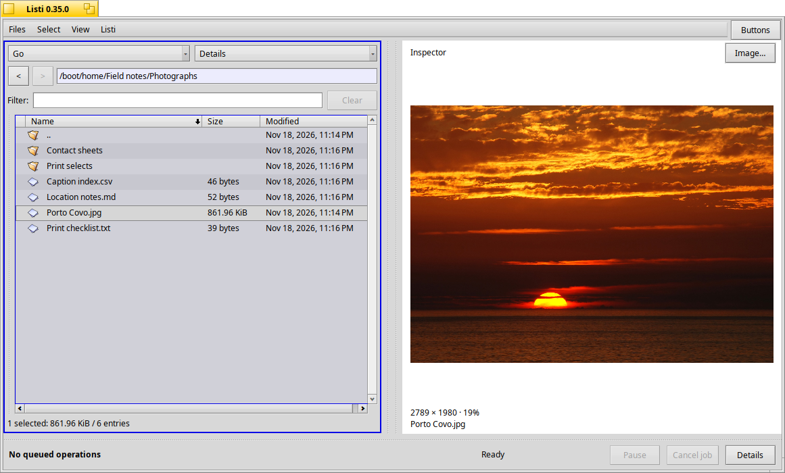

# Listi

Listi is a native Haiku file manager. Browse a single folder, compare two panels side by side, or use the Smiðja workspace to keep a file list, search results and a terminal in the same window.



*Quick view in Listi 0.35.0. [Image credit](docs/screenshots/CREDITS.md).*

## Install

Download the **[0.36.1-3 test candidate for Haiku x86_64](https://github.com/kambuziarendal/listi/releases/tag/v0.36.1-3)**. Open the HPKG in HaikuDepot, or install it from the download folder:

```sh
pkgman install ./Listi-0.36.1-3-x86_64.hpkg
```

This is a prerelease tested on Haiku R1/beta6 in a virtual machine. Try it on copies of your files. To transfer files between disks, use **Copy**, remount the destination and check the copy before removing the original. Unplugging a disk during a write can leave the job waiting even after you click Cancel.

## Basic workflow

Choose **View > Workspace**, open the source and destination folders, then select files in the source panel. **Quick view** previews the selected file without opening another application. In Smiðja, use **Show original** on a search result to select it in the file list.

See the [feature tour](docs/FEATURES.md) for screenshots or the [workflow guide](docs/GUIDE.md) for shortcuts, archives and network locations.

## Build from source

On Haiku x86_64:

```sh
pkgman install haiku_devel python3 libarchive_devel zlib_devel curl_devel samba4_devel
make
```

Run `make test` for the built-in self-test or `make package` to create an HPKG in `dist/`. See [testing and known limits](docs/VERIFICATION.md) for the full native audit.

[Changelog](CHANGELOG.md) · [Roadmap](docs/ROADMAP.md) · [Report a bug](https://github.com/kambuziarendal/listi/issues) · [Licence](LICENSE)
