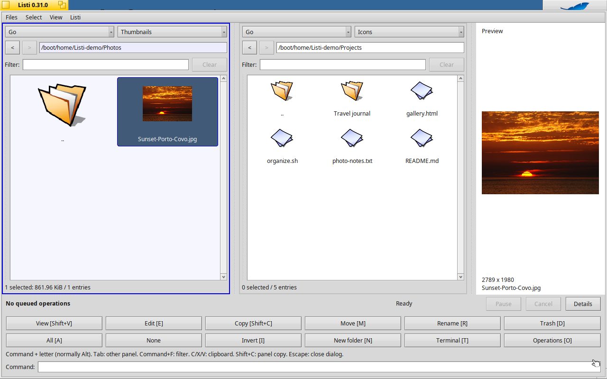

# Listi

**A native file manager for Haiku, built for anything from quick browsing to
two-panel file work.**

| Smiðja | Tvískipt |
|---|---|
|  |  |
| A workspace that brings files, navigation, preview, filters and actions together. | A focused source-and-destination layout inspired by Directory Opus. |

Listi combines Haiku's native controls, filesystem attributes, queries and
Tracker interoperability with several ways of working in one application. Use a
single file list, browse with a folder tree, work across two panels, or gather
more tools in the Smiðja workspace.

[Download Listi 0.31.1 alpha](https://github.com/kambuziarendal/listi/releases/tag/v0.31.1)
· [Report a bug](https://github.com/kambuziarendal/listi/issues)
· [Read the design](docs/DESIGN.md)
· [See the roadmap](docs/ROADMAP.md)

## Four workspaces, one file manager

- **Einn** (`einn`) is a simple, Tracker-like view with one file panel. Folders
  open in the same window by default.
- **Askr** (`askr`) places a folder tree on the left and a file list on the
  right, like a classic Explorer layout.
- **Tvískipt** (`tviskipt`) puts two file panels side by side. Direct Copy and
  Move use the other panel as the destination.
- **Smiðja** (`smidja`) is the workbench, with file panels, folder trees, image
  preview, filters and action buttons in one layout.

Switching workspace keeps panel locations, selections and running jobs. Einn
and Askr use the active panel; the other panel is hidden, not discarded.

The screenshots above are real captures of the 0.31.0 development alpha, before
the workspace rename. That build labels Smiðja as **Workbench** and Tvískipt as
**Commander**. The current 0.31.1 release uses the names shown here. Listi is an
independent implementation and is not affiliated with Directory Opus.

Photo shown in the Smiðja preview: [Sunset 2007-1](https://commons.wikimedia.org/wiki/File:Sunset_2007-1.jpg)
by Alvesgaspar, [CC BY-SA 3.0](https://creativecommons.org/licenses/by-sa/3.0/).
[Screenshot and photo credits](docs/screenshots/CREDITS.md).

## What is already here

### Native file work

- Two independent, resizable file panels with editable paths, sortable columns,
  multiple view styles, thumbnails, selection and drag-and-drop.
- Copy, move, rename, duplicate, symbolic links, new folders, Trash and explicit
  permanent deletion.
- Conservative transfers: existing destinations are not silently replaced,
  incomplete regular files are removed on cancellation, and Trash never falls
  back to permanent deletion.
- A worker queue with progress, pause, resume, cancellation and explicit
  Replace, Skip and Abort choices when conflicts occur.
- Folder history, saved places and per-folder display preferences.

### Haiku integration

- Native controls and system colours, including dark themes.
- BFS attributes in Properties, native BFS queries and optional live search.
- Clipboard interoperability with Tracker and Tracker-compatible Trash restore
  metadata.
- File monitoring so local directory changes can appear without a manual reload.

### Search, compare and inspect

- Literal panel filters plus cancellable recursive name search.
- Date, byte-size and extension criteria, saved searches and advanced BFS
  formulas.
- Read-only folder comparison by size or SHA-256 content.
- Image preview, file viewer, external editor launch and terminal launch.

### Archives and network locations

- Create and extract common archive formats through the optional system
  `libarchive` package.
- Browse many archive formats, including ZIP, 7z, RAR, tar, ISO, CAB and LHA.
- Safely edit supported local ZIP and 7z archives, with destination verification,
  conflict detection and retained recovery copies where needed.
- Connect to SMB, SFTP, FTP and FTPS locations. Credentials stay in memory;
  protocol and server limitations are reported instead of being hidden.

Exact behavior and limits are documented in the linked feature notes under
[`docs/`](docs/). The current stability qualification is in
[`STABILITY-0.31.0.md`](docs/STABILITY-0.31.0.md).

## Alpha software: read before testing

**Listi is under active development. It operates on files, and bugs can cause
data loss or corruption during copying, moving, editing or deleting.**

Use it at your own risk. Test with disposable copies and keep independent
backups. The published binaries are intended primarily for bug testing, not for
dependable everyday use. We do not recommend using this alpha unless you
understand and accept the risk.

If you test Listi, please [report serious bugs](https://github.com/kambuziarendal/listi/issues)
with the Listi version, Haiku version, reproduction steps and whether files were
affected. Do not include passwords or private files in a public report.

## Install

Listi 0.31.1 is available for **Haiku x86_64** as an HPKG and as a ZIP containing
the same package. Checksums are included on the release page.

```sh
pkgman install ./Listi-0.31.1-1-x86_64.hpkg
```

[Download the current alpha](https://github.com/kambuziarendal/listi/releases/tag/v0.31.1)

Keep the previous package if you want application rollback. Reinstalling an old
version does not undo file operations or restore deleted or overwritten data.

### Current release

0.31.1 changes the project and workspace names without adding file-management
features. Existing settings load without manual migration. Scripts that compare
the native `Workspace` result must use the new display names.

The 0.31.0 stability work covered recoverable directory delivery, retained queue
results, bounded archive-read reuse and network recovery after lost replies.
See the [0.31.1 release notes](https://github.com/kambuziarendal/listi/releases/tag/v0.31.1)
and [measured stability limits](docs/STABILITY-0.31.0.md).

## Basic workflow

The highlighted panel is the active source. Direct panel Copy or Move uses the
other panel as the destination; clipboard Paste uses the active panel. Click a
panel or press Tab in a file list to switch roles.

Haiku's **Command modifier** is normally **Alt**, depending on the system keymap.
The main shortcuts are:

| Action | Shortcut |
|---|---|
| Copy, cut and paste through the clipboard | Command+C / X / V |
| Copy directly to the other panel | Command+Shift+C |
| Move directly to the other panel | Command+M |
| View or edit | Command+Shift+V / Command+E |
| Rename, new folder or Trash | Command+R / N / D |
| Filter the active panel | Command+F |
| Find files | Command+Shift+F |

Function keys are deliberately unassigned. Menus and context menus expose the
same actions without requiring shortcuts.

## Build from source

Build the current application inside **Haiku x86_64**:

```sh
pkgman install haiku_devel python3 libarchive_devel curl_devel samba4_devel
make
make test
make package
```

The executable is written under `src/objects.*-release/Listi`. The package is
written under `dist/`. The project, executable and package are named **Listi**;
the repository and package ID use `listi`.

Compatibility-only identifiers keep the historical `Lister` spelling, including
the application signature, scripting suite, settings paths and package aliases.
Numeric workspace values are unchanged and legacy settings keys are read beside
the new ASCII IDs. No manual settings migration is required. See
[Names and compatibility](docs/DESIGN.md#names-and-compatibility).

## Project status and direction

Listi is a Haiku-native development alpha, not a claim of feature parity with
Directory Opus, Tracker, Dolphin or another established file manager. Broader
previews, text editing, configurable Smiðja modules, an optional terminal,
stronger job results and a future automation layer remain planned work.

The immediate development order is documented in the [roadmap](docs/ROADMAP.md):
file-operation qualification, a stronger job model, then an internal command
registry. Lua, hooks, external automation and persistent undo are later decisions,
not features promised by this release.

Useful technical references:

- [Architecture and compatibility](docs/DESIGN.md)
- [Roadmap](docs/ROADMAP.md)
- [Verification overview](docs/VERIFICATION.md)
- [Tracker capability coverage](docs/TRACKER-COVERAGE.md)
- [Archive workflows and limits](docs/ARCHIVES-0.18.0.md)
- [Search behavior and limits](docs/SEARCH-FILTERS-0.30.0.md)

## Licence

Listi's source is licensed under the MIT licence. Optional libraries and tools
provided by Haiku packages retain their own licences. There are no accounts,
telemetry or paid services in Listi.
