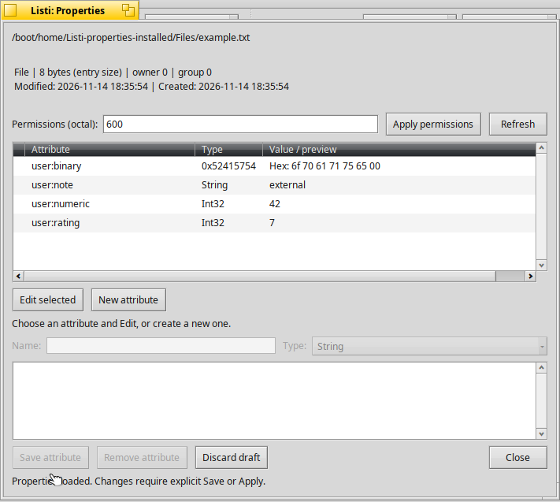
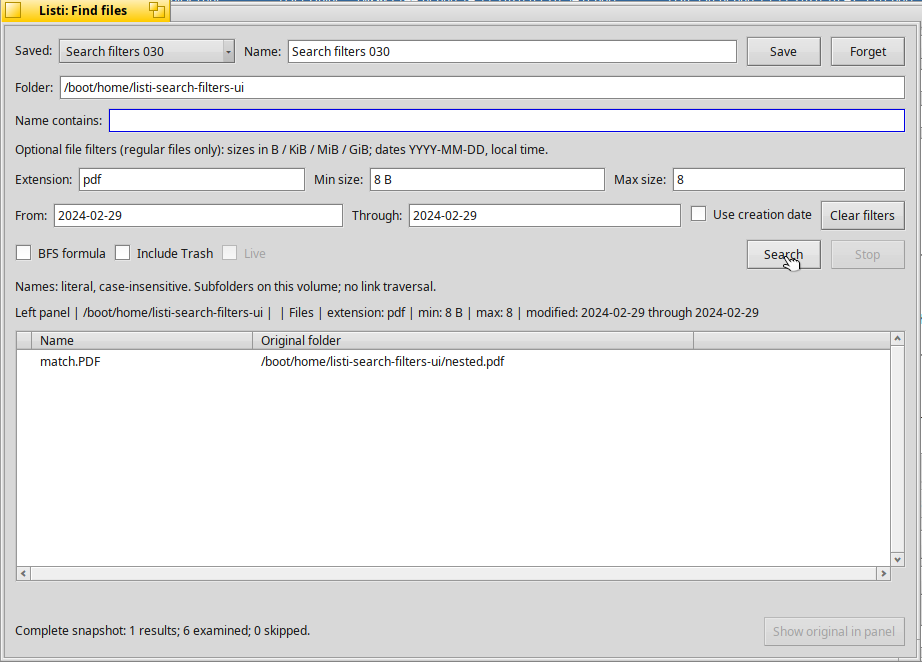
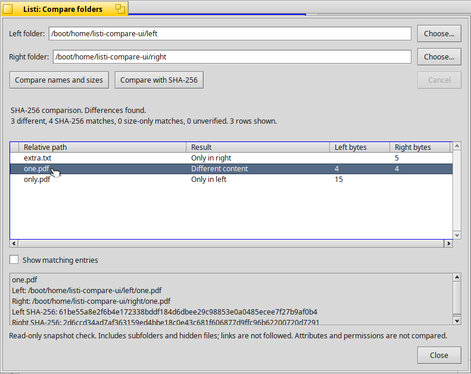
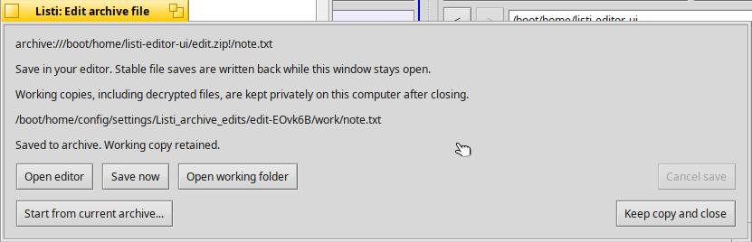

# Workflow guide

This guide describes the 0.32.0 alpha. Test with disposable copies and keep
independent backups: file operations can fail or complete only partially.

## Small features at a glance

These are implemented conveniences in the 0.32.0 alpha. Availability depends on
whether the location is local, an archive or a network provider; disabled menu
items are not promises of support.

### Right-click: the selection or the current folder

- **Selected files / This folder:** change the menu's target without leaving it.
  **This folder** is the panel's current directory, not a selected child folder.
- Right-clicking an unselected entry selects that entry. Right-clicking an
  already selected entry retains the multi-selection.
- **Selected files:** Open, applicable Open with/View/Edit, Copy/Cut, direct
  Copy/Move to the other panel, Rename, Duplicate, symbolic links, Trash or
  archive removal, archive actions and Properties as supported by the target.
- **This folder:** Sort by, View, New folder, Paste here, Refresh, Terminal here
  and Properties where applicable.
- **Select same file type:** replace the selection with visible ordinary files
  sharing the clicked file's case-insensitive extension. Folders and links are
  excluded; it is not MIME detection. Recognised compressed-TAR suffixes remain
  distinct from a plain compressed stream.

**Sorting and type selection are different:** sorting supports **Name, Size and
Modified**, each ascending or descending. **Sort by file type is not implemented**
in this alpha.

### Navigation, views and selection

- Independent Back/Forward history per panel; double-click folders, use an
  editable path, or go up with Backspace while browsing the list.
- **Go:** Parent, Root, Home, Desktop, Disks and Trash on the current volume.
- **Places:** save the current location under a name, rename it, forget it or
  reopen it. Saving a place is not saving credentials.
- **Same folder in other panel:** open the active location on the other side.
- **View:** Details, Icons, Large icons, Thumbnails and Miller columns; optional folder tree per
  panel. Details columns can also be used to choose sort order.
- **Remember view for this folder / Use default for this folder:** save or clear
  a folder-specific display-mode override. This is not a saved workspace or a
  promise to remember every column, tree or sort setting per folder.
- **All, None, Invert:** apply to the visible list; filtered-out entries do not
  silently rejoin the selection when revealed.
- **Selection summary:** selected file bytes, folder/link counts and unavailable
  sizes are distinguished. Folder contents and link targets are not recursively
  included in that byte total.
- **Filter:** Clear or Escape removes the filter; Enter returns to the list.
  The filter is a literal name match, not a wildcard expression.
- **Keyboard selection:** Space toggles the focused entry; icon views also
  support arrows, Shift+arrows for range selection, Home/End and Enter to open.
  Tab switches panels in the dual-panel workspaces.

### Search and comparison conveniences

- **Save / Forget search:** keep named criteria rather than frozen result rows.
- **Show original in panel:** navigate from a search hit back to its location.
- **Use creation date / Include Trash / Live:** explicit search choices where
  applicable. Clear filters removes the extension/size/date conditions without
  clearing the name, BFS formula or search root.
- **Show matching entries:** include matches in folder-comparison results rather
  than displaying differences alone. Select a result for paths, digests and
  error details. Size-only equality is not content verification.

### Tools and preferences

- **Terminal here:** start an interactive shell in the active local folder.
  Choose **Below file panels** or **Beside file panels** to keep the shell in
  the Listi window, or **Separate window** to launch the configured terminal.
- **Open with:** choose a native application once without rewriting associations.
- **Properties:** inspect metadata and explicitly save supported local typed
  attributes or ordinary permissions; opening the window alone changes nothing.
- **Workspace defaults:** All workspaces start in Details. Change each default in **Listi > Settings**. A remembered
  folder view takes priority. **View > File view > Use workspace default**
  clears the current folder and panel overrides.
- **Settings:** show/hide file icons, Size/Modified columns, the action button
  bank and the command field where the workspace exposes them; choose list font,
  file/folder/link colours, editor and terminal applications.
- **Command field:** type a command and press Enter to run it in a separate
  terminal, starting in the active local folder. For example, `pwd` prints
  that folder’s path. The shell stays open after the command finishes.
  Showing the field does not start a shell or run anything.
- **Operations:** reopen the progress window after hiding it; pause/resume,
  cancel and choose Replace/Skip/Abort when conflicts occur.

### Custom workspaces (development build)

Open **View > Workspace > Customize workspace…**. The four built-in presets
still work without changing any settings.

- **Action buttons:** remove buttons you rarely use and move the others into
  your preferred order. Removing a button does not remove its menu command
  or keyboard shortcut.
- **Modules:** place the button bank and command line above or below the panels,
  position the folder trees and name filters, or move the preview before or
  after the file panels. Arrange the panels side by side or vertically. The
  preset still determines which tools are available. Enable compact buttons
  to reflow the bank in a narrow window; turn the option off to keep the
  standard grid. Resizing does not choose another folder or file view. Stacked
  panels with a preview and both toolbars need more vertical space; side-by-side
  panels are a better fit for shorter screens.
- **Smiðja sidebars:** choose a folder tree, favourite destinations, or no
  sidebar independently for each file panel under **Modules**. To change one
  panel directly, use **Sidebar** in its display menu.
- **Smiðja preview:** select a file to inspect an image, plain text, source
  code, Markdown or HTML source, a PDF page, or audio/video supported by the
  installed decoders. Use the page buttons for PDFs or **Play preview** for a
  media sample of up to 15 seconds. Selecting media does not start playback.
- **Profiles:** name the current draft and choose **Create**. Later, select a
  profile and choose **Load** to use it or **Update** to replace its saved
  layout. Profiles remember layout, not open directories or selected files.

**Save** applies the draft and its profile changes together. **Cancel** or Escape
discards both. **Reset layout**, followed by **Save**, restores the standard layout
without deleting named profiles, folder-specific views, colours or application
choices.

### Archive conveniences

- Favourite formats appear directly; others are grouped under **More formats**.
  Choose a default, **Ask for a format every time** and a compression level per
  format where supported. Changing format updates the proposed extension.
- Choose an output folder and name. Extraction proposes a new “... extracted”
  folder rather than merging silently into an existing destination.
- AES-256 protection for supported ZIP/7z creation, with optional filename
  encryption for 7z.
- **Forget archive passwords:** explicitly clear the in-memory password cache
  and pending creation tokens; this does not delete decrypted working copies.
- **Resume archive edits**, **Save now**, **Open working folder** and **Start
  from current archive:** manage retained external-editor sessions. Decrypted
  working copies may remain on disk; read the recovery notes below.

## Panels and jobs

The highlighted panel is the source. Direct Copy or Move uses the other panel
as the destination; clipboard Paste uses the active panel. Accepted jobs retain
their selected paths and target even if you navigate or switch workspace.

To save copied text, choose **Files > Clipboard > Save clipboard text as file**
in a writable local folder. Keep the suggested name, `Clipboard.txt`, or enter
your own. Listi saves the text as copied, without running it or replacing an
existing file. For a copied image, use **Files > Clipboard > Save clipboard
image as PNG**. It accepts PNG data and native Haiku bitmaps and suggests
`Clipboard.png`. Both commands save the clipboard contents selected when
the naming prompt opened. To paste copied files instead, use **Paste**.

In the development build, open **Operations > Details** and choose a job by
number to review its result, even after another job has started. **Recent
activity** is the combined log; a specific job shows its source and destination
paths where available. Large reports have multiple pages. Job results are for
this session, not saved to disk. **Clear finished** frees completed reports without cancelling any jobs.

For a local move, **Moved** means Listi committed the move. **Copied; source
retained** means the destination copy was made but Listi did not remove that
source entry. **Partially completed** means some changes were made inside the
folder: check its individual entries. **Skipped** identifies an entry passed
over, **Failed** includes the problem, and **Not processed** is not a success.
Other providers can give a job-level error or a recovery path rather than
confirm the state of every file. Concurrent external edits are not prevented.

**Cancel job** stops the running job only. In Details you can cancel a selected
waiting job, or choose **Cancel all** to stop the running job and discard waiting
jobs. None of these actions undoes work already committed.

Trash and permanent deletion are separate actions. Trash restore does not
overwrite an existing file and requires the original parent folder to exist.
Reinstalling an older application package does not undo file operations.

## Navigation, selection and native tools

Panels offer details, icon and thumbnail views, history, saved places and optional
folder trees. Switching workspace retains the panel objects rather than
restarting file work. **Select same file type** replaces the active panel's
selection with visible ordinary files sharing an extension; it is not MIME or
content detection. `.jpg` and `.jpeg` remain distinct.

**Shelf (development build):** Select local entries and press Command+Shift+Y
(**Files > Add to Shelf**). Open **Listi > Show Shelf** to see their names,
original folders and status. You can also drop local entries onto the list.
Removing a row removes only the reference. Closing and reopening the Shelf
keeps its contents; quitting Listi clears it.

**Copy all...** and **Move all...** act on the whole Shelf, not just
highlighted rows. Choose a destination folder and follow progress in
Operations. Copy leaves the originals and the Shelf references in place.
Remove unavailable or replaced references before submitting another job.

**Create archive...** opens the archive dialog for the whole Shelf. Choose
the destination, archive name and format. Use **Change format...** if the
format options are hidden. Each entry appears at the top level under its
original name. If two entries have the same name, remove one reference
before packing. Creating an archive leaves the originals and Shelf unchanged.

Local drag-and-drop asks Copy here, Move here or Cancel for the receiving
panel's current folder, not the row under the pointer. Duplicate and symbolic
link creation are local, single-entry actions; links can be relative or absolute.
Archive and network drops remain copy-only.

**Convert here (development build):** Drop one local image onto a local panel,
choose **Convert here**, select a format and confirm **Convert**. The choices
depend on the image and the installed Haiku translators. Listi creates a new
file in the receiving folder and won't replace the original or an existing
output file.

**Bulk rename (development build):** Select two or more entries in one local
folder and choose **Files > Bulk rename...**. Enter a prefix, suffix, case-sensitive replacement or sequence number, then
choose **Update preview** to compare current and proposed names.
File extensions are kept. Occupied or duplicate names block the batch. Choose
**Apply rename** to queue the displayed changes. If interrupted, completed
renames stay in place; check operation history before retrying.

**Files > Properties** pins one local entry and exposes timestamps, numeric
ownership, ordinary octal permissions and supported typed BFS attributes. Saves
are explicit. System namespaces, unsupported binary data and metadata beyond the
editor's limits remain read-only; this is not a MIME editor or bulk attribute tool.
Detected concurrent changes block editing, but checks cannot lock out all other
programs or guarantee power-loss atomicity.

*Properties, captured in 0.10.0 with synthetic data; cropped to the native window.*

**Files > Open with...** offers installed native applications for one local
regular file. **Open once** does not change associations. Remote/archive members
must be copied locally for that dialog; ordinary archive Edit has its own
save-back workflow described below.

## Filtering and search

A panel's name filter is a local view filter, not recursive search or shell
wildcard expansion. Hidden rows are deselected; Select All and file operations
act on visible selections. New navigation clears the filter; refreshing the same
folder preserves it.

**Listi > Find files** combines a name fragment or BFS formula with extension,
size and date criteria. Saved searches store criteria, not copies of results.
Advanced BFS queries can subscribe to live changes. Search results refer to
original files: deleting a result's file deletes the original.

Search is currently limited to one persistent local volume, 5,000 displayed
hits and 250,000 examined entries, with explicit incomplete/error outcomes.
Content, archive-internal, remote and multi-volume search are not supported.
Date filters apply to current files, not historical snapshots.

*Find files, captured in 0.30.0 with synthetic fixtures.*

## Folder comparison

**Listi > Compare folders...** compares relative names and types recursively.
Size mode does not verify equal content; SHA-256 mode reads content on both
sides. Comparison is read-only: it does not repair or synchronise anything.
Permissions, ownership and BFS attributes are not compared.

Keep both folders idle for meaningful results. Comparison is not a snapshot;
remote checks depend on the server's metadata, and hashing can download entire
files. Limits are 100,000 entries per side, 256 levels and 5,000 displayed rows;
truncation and incomplete scans are reported.

*Comparison, captured in 0.28.0; the selected files have equal size but different content.*

## Archives

Available formats depend on optional system libraries and engines. Listi can
browse many formats, but reading, creation and editing are different
capabilities. A successful listing does not establish member-data integrity.

- Supported local single-volume writers include ZIP, 7z, TAR, TAR with gzip,
  xz, bzip2, LZMA, lzip or Unix compress (.tar.Z), CPIO and XAR. Zstandard/LZ4 wrappers are gated by the
  installed engine rather than universally promised. Reading support is broader
  than writing support.
- Unix ar archives support flat regular files. Edits preserve GNU or BSD
  naming. Debian packages and static libraries are not rebuilt as generic ar;
  thin archives with external references are not opened.
- With p7zip installed, Listi can create single-volume ARJ archives with
  portable ASCII names. Install the optional HaikuPorts `arj` package for
  compression. Level zero (or no compressor installed) uses Store. Listi
  can edit archives with its portable header layout. Compatible DOS/Windows ARJ archives can also be read, including
  compressed members; other header variants are not assumed editable.
- LHA/LZH can be created and edited when the optional HaikuDepot `lha` tool
  and libarchive are installed. Level zero stores files; other levels use LH7.
- Single-volume Microsoft Cabinets support Store at level zero and MSZIP
  compression at levels 1 to 9 when system zlib is available.
  Nonempty folders are represented by their member paths. CAB cannot store an
  empty folder; an edit that would leave one is refused without replacing the
  archive. Signed, spanned and unsupported Cabinet variants are not editable.
- Listi can create ISO 9660 data discs. It verifies the member names, contents
  and permissions and records the image digest in a filesystem attribute.
  Only images with that matching attribute can be edited. Other images
  remain browseable where supported; they are not rebuilt as plain data discs.
- Writable archive folders support Copy/Paste, new folders, rename, entry removal
  and supported moves. Removing an archive member is not local Trash. Editing
  rebuilds the container and needs scratch space for extracted content and the
  new archive; layout, comments and format-specific metadata may change.
- Supported encrypted ZIP, 7z and RAR inputs use a masked password flow.
  Passwords are kept in process memory rather than saved in settings.
- Selected local multipart 7z and RAR naming families are supported for reading.
  All parts must remain together and unchanged. This does not imply split ZIP,
  split creation or repair support.
- Supported local archive-to-archive and archive/local moves verify destination
  contents before source cleanup. They are not an atomic two-location
  transaction and have no automatic crash-resume journal.
- Archive/local moves refuse unsupported metadata and file types rather than
  silently discarding them, including BFS attributes, source symlinks, special
  files and some hard-link cases. Use Copy to retain originals.
- With the p7zip RAR5 reader installed, Listi writes single-volume RAR5 using
  Store (no compression). Ordinary existing RAR5 files, including supported
  compressed members, can be edited if their metadata can be retained.
  Rebuilding may increase the file size. RAR4, encrypted or multipart RAR,
  recovery records and unsupported metadata are not writable.
- Remote, split and nested archives cannot be edited in place.

A failed or cancelled merge may leave destination copies, and cleanup may stop
after some verified entries have moved. Inspect both locations before retrying.

### Editing an archive member

Select a regular member in a supported writable local archive and choose **Edit**.
Listi opens a private working copy in the configured external editor. While the
edit window remains open, stable editor saves can be written back through a
verified archive rebuild. **Save now** retries a paused save; external archive
changes stop automatic saving rather than being silently overwritten.

*Archive save-back, captured in 0.27.0 with a synthetic text file.*

Working copies and recovery records remain under
`~/config/settings/Listi_archive_edits/edit-*/`. **Decrypted contents are not
encrypted at rest.** Keeping a copy, closing or cancelling does not remove it.
Use **Files > Archives > Resume archive edits** to resume a retained session.
After closing edit windows and preserving needed work, remove obsolete copies
manually. This is not write-back from arbitrary Open or Open With applications.

## Network locations

SMB, SFTP, FTP and FTPS use the panel and job interface. Capabilities and recovery
behaviour vary by protocol and server. Comparison or previews can cause network
reads, including downloading complete files. Keep credentials out of shared URLs,
screenshots and bug reports.

## Settings and older versions

The 0.31.1 naming update retains existing workspace values and settings aliases.
Saved search criteria written since 0.30 use a newer store format: 0.29 and older
cannot read it. Those versions preserve the file and disable saved-search changes;
upgrading restores access. Do not replace the store with a stale backup merely
to make an older version read it.
